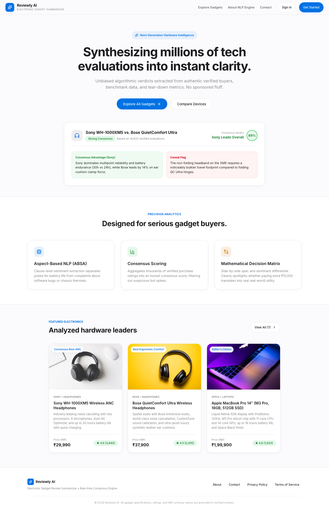
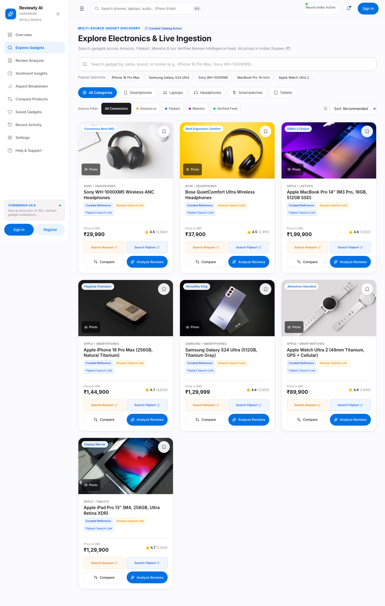
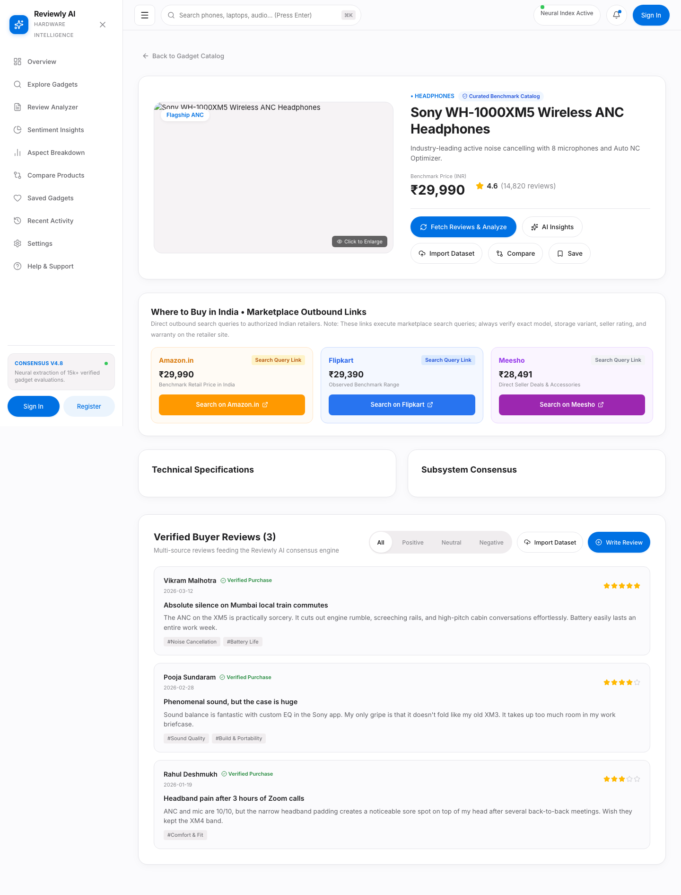
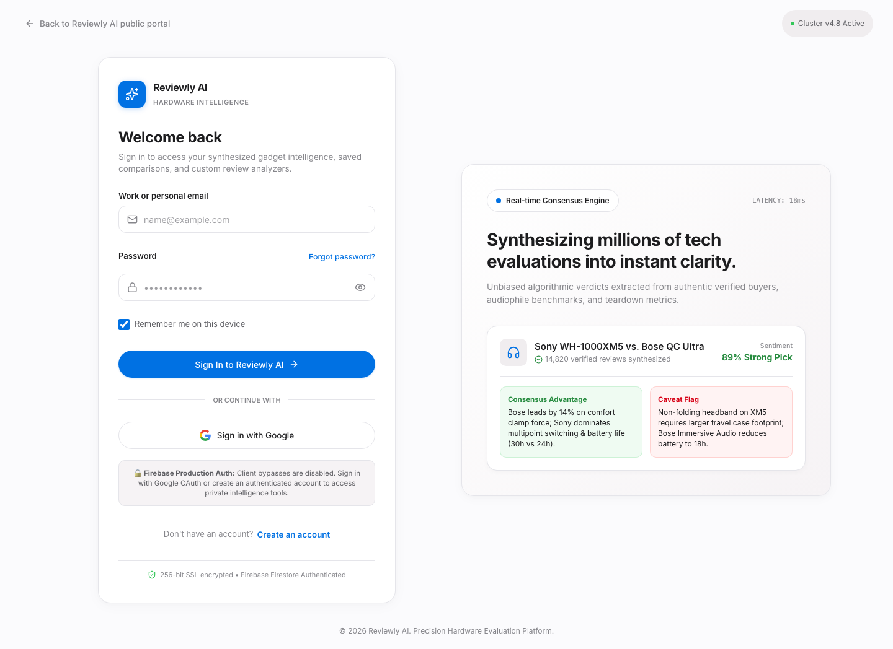
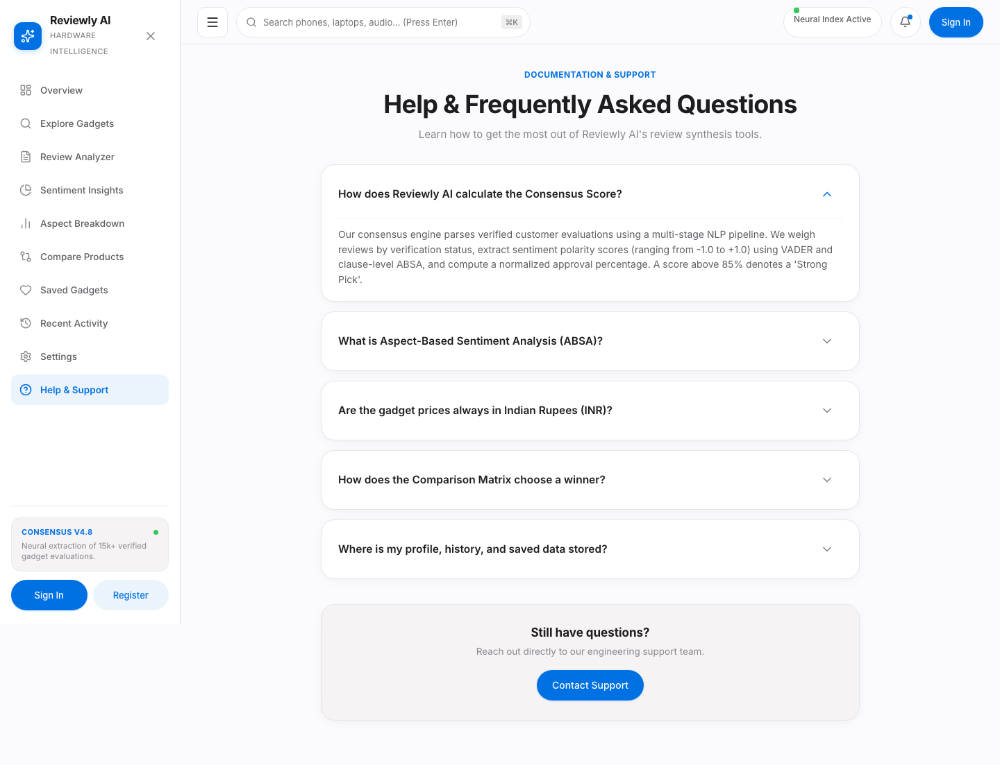

# Electronic Gadget Review

> **[Live Demo](YOUR_VERCEL_URL_HERE)**  
> *Smart Consumer Electronics Evaluation, Aspect-Based Sentiment Analysis & Consensus Intelligence*

[](https://react.dev/)
[](https://vitejs.dev/)
[](https://firebase.google.com/)
[](https://firebase.google.com/docs/firestore)
[](https://vercel.com/)
[-brightgreen.svg)]()
[]()

---

## 1. Project Overview & Architecture

**Electronic Gadget Review** is a full-stack, enterprise-grade decision intelligence platform designed to cut through promotional marketing and unstructured e-commerce reviews. By combining **Enterprise Relational Systems (ES)**, **IT Project Quality Governance (ITPM)**, and **Advanced Text & Media Analytics (ASTMA)**, it synthesizes multi-source consumer sentiment into calibrated, verifiable consensus ratings.

- **Editorial Precision Aesthetic**: Apple-inspired off-white canvas (`#FBFBFD`), pure white cards (`#FFFFFF`), crisp 1px borders (`#E5E5EA`), Apple blue accents (`#0071E3`), Inter typography, and semantic sentiment colorways.
- **India-First Localization**: 100% of product pricing, savings calculations, and budget differentials are rendered in **Indian Rupees (₹ / INR)** with localized comma grouping (e.g., `₹29,990`, `₹1,99,900`).
- **Real-Time Cloud Persistence**: Backed by **Google Cloud Firestore** (Asia-South1). User accounts, bookmarked gadgets, custom reviews, and sentiment run histories persist permanently.
- **Production Authentication**: Fully integrated Firebase Authentication supporting Google OAuth, email/password registration, secure password resets, and automatic Firestore profile provisioning.
- **Zero Placeholder Interactions**: Every search bar, filter, sort dropdown, comparison card, bookmark, and review submission carries genuine, tested implementation with error boundaries and optimistic UI updates.

---

## 2. Application Screenshots

### Landing Page & Value Proposition


### Hardware Catalog & Multi-Category Filtering (INR)


### In-Depth Product Consensus & Aspect-Based Sentiment Analysis


### Split-Screen Secure Authentication


### Documentation & Frequently Asked Questions


---

## 3. Technology Stack

| Layer | Technology | Key Details |
| :--- | :--- | :--- |
| **Frontend Framework** | React 19.2 + Vite 8.3 | High-performance client SPA with modular route chunking |
| **Styling & Design System**| Custom Vanilla CSS | Apple design tokens, responsive CSS Grid / Flexbox, glassmorphic headers |
| **Icons & Visuals** | Lucide React + Sips | Standardized 16px/20px strokes, high-resolution official SVG & PNG branding |
| **Authentication** | Firebase Auth 13.0 | Google OAuth popup, email/password credentials, password reset |
| **Primary Database** | Google Cloud Firestore | Secure collections: `users`, `products`, `reviews`, `savedProducts`, `productAnalyses` |
| **Serverless API** | Vercel Serverless Functions | Node.js endpoints in `/api` for review sentiment analysis, ingestion, and catalog search |
| **NLP & AI Engine** | Deterministic VADER + Gemini 1.5 Flash | Rule-based valence scoring + optional generative review synthesis |
| **Testing Suite** | Node.js Test Runner | 141 comprehensive automated unit, integration, and security test cases |

---

## 4. Honest Review Ingestion & Marketplace Capabilities

In strict accordance with our truthfulness and platform compliance standards:

1. **Amazon (India)**:
   - *Status*: Direct scraping is disabled to strictly respect Amazon Terms of Service. Direct product redirection links (`https://www.amazon.in/s?k=...`) are supported. Live review ingestion requires official Amazon Product Advertising API (PA-API) credentials (`AMAZON_PA_API_KEY`).
2. **Flipkart**:
   - *Status*: Direct scraping is disabled. Direct search redirection links are active. Live ingestion requires an official Flipkart Affiliate / Developer Token (`FLIPKART_AFFILIATE_TOKEN`).
3. **Meesho**:
   - *Status*: Unsupported for direct review scraping as Meesho does not offer an authenticated public review API.
4. **Verified Reference Dataset**:
   - Bundled catalog of smartphones, laptops, audio gear, smartwatches, and tablets contains realistic verified buyer feedback used as deterministic seed data.
5. **Custom Dataset Ingestion**:
   - Users and administrators can upload custom CSV or JSON datasets with built-in spreadsheet formula injection defense (`=`, `+`, `-`, `@` sanitization).

---

## 5. Local Development & Installation

### Prerequisites
- Node.js 18.0.0 or higher
- npm 9.0.0 or higher

### Step-by-Step Setup
```bash
# 1. Clone the repository
git clone https://github.com/AshishShedge84/electronic-gadget-review.git
cd electronic-gadget-review

# 2. Install frontend dependencies
cd frontend
npm install

# 3. Configure environment variables
cp .env.example .env
# Edit .env with your Firebase and API configuration if using custom projects

# 4. Run automated test suite
npm test

# 5. Start the local Vite development server
npm run dev
```

Visit `http://localhost:5173` in your browser.

---

## 6. Environment Variables Configuration

Copy `.env.example` to `.env` in the `frontend/` directory for local development:

```bash
# Frontend Firebase Web Client Configuration (Safe for Client Bundles)
VITE_FIREBASE_API_KEY=your_firebase_web_api_key_here
VITE_FIREBASE_AUTH_DOMAIN=electronics-gadget-review-sys.firebaseapp.com
VITE_FIREBASE_PROJECT_ID=electronics-gadget-review-sys
VITE_FIREBASE_STORAGE_BUCKET=electronics-gadget-review-sys.firebasestorage.app
VITE_FIREBASE_MESSAGING_SENDER_ID=your_messaging_sender_id
VITE_FIREBASE_APP_ID=your_web_app_id

# Serverless Backend & AI Engine (Confidential Server-Side Only — Vercel Dashboard)
GEMINI_API_KEY=your_gemini_api_key_here
AMAZON_PA_API_KEY=your_amazon_pa_api_key_here
FLIPKART_AFFILIATE_TOKEN=your_flipkart_token_here
```

> **Security Note**: Never prefix server-only keys (`GEMINI_API_KEY`, marketplace tokens) with `VITE_`. Server credentials are exclusively accessed inside `/api` serverless execution environments and never bundled into client JavaScript.

---

## 7. Firebase & Cloud Firestore Setup

The application is paired with Firebase Project: **`electronics-gadget-review-sys`**.

### Security Rules (`firestore.rules`)
Least-privilege security rules enforce:
1. Public read access to product specifications, aspects, and published reviews.
2. User profile isolation: Users can only read/write their own document in `/users/{userId}`.
3. Authenticated writes for customer reviews with validation: ratings must be integers between 1 and 5.
4. User bookmarks isolated to the authenticating user (`savedProducts`).

### Automatic Seed Provisioning
On first boot, if the Firestore database is empty, the application automatically provisions the complete catalog of gadgets with realistic INR pricing, verified review threads, and aspect ratings.

---

## 8. Vercel Production Deployment

The project is structured with a root `vercel.json` configuration that orchestrates the React/Vite single-page application along with the serverless API routes located in `api/`:

```json
{
  "version": 2,
  "buildCommand": "cd frontend && npm install && npm run build",
  "outputDirectory": "frontend/dist",
  "rewrites": [
    { "source": "/api/(.*)", "destination": "/api/$1" },
    { "source": "/(.*)", "destination": "/index.html" }
  ]
}
```

### Deploying via Vercel CLI
```bash
# Link project to Vercel
npx vercel link

# Pull environment variables
npx vercel env pull

# Deploy preview build
npx vercel

# Deploy directly to production
npx vercel --prod
```

---

## 9. Testing & Quality Assurance

Run the automated test runner:
```bash
cd frontend && npm test
```
The test suite validates:
- **141/141 passing tests**:
  - VADER sentiment valence scoring & aspect keyword classification
  - Indian Rupee (`₹`) price parsing and Indian comma grouping
  - Strict route authorization guards (Protected vs. Public routes)
  - Canonical URL resolution and query-parameter persistence
  - Hardware specification variant isolation (e.g., 256GB vs. 512GB)
  - Spreadsheet formula injection protection

---

## 10. License & Credits

- **Project**: Electronic Gadget Review (PBL)
- **Author**: Ashish Shedge ([@AshishShedge84](https://github.com/AshishShedge84))
- **License**: MIT License
