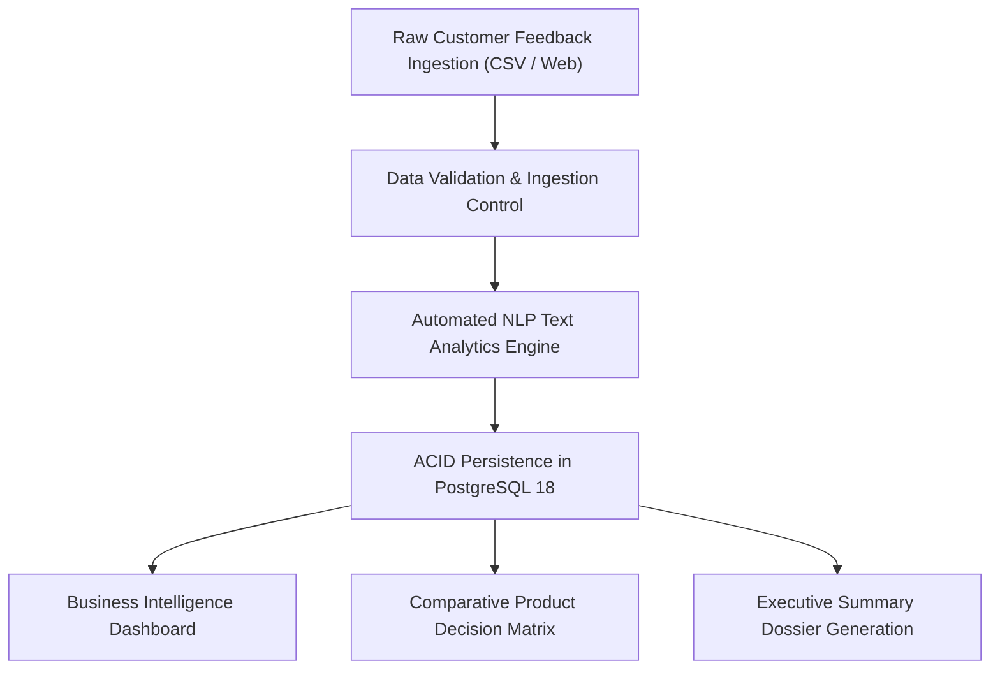
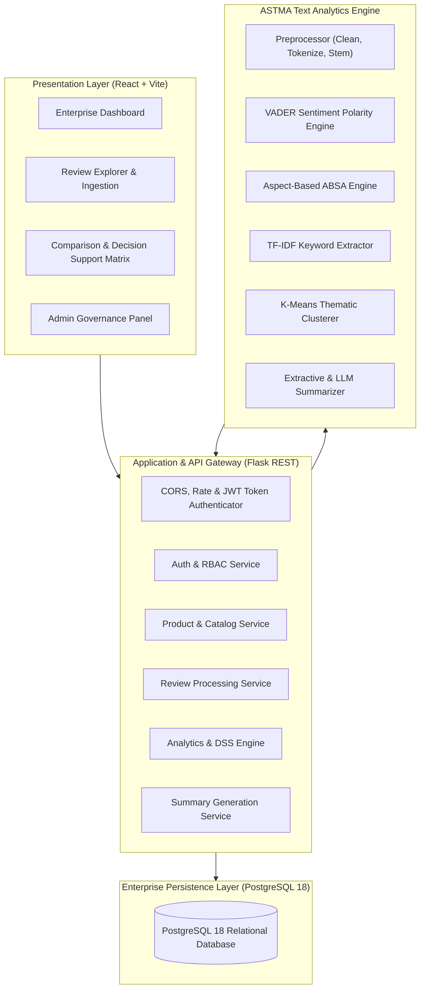
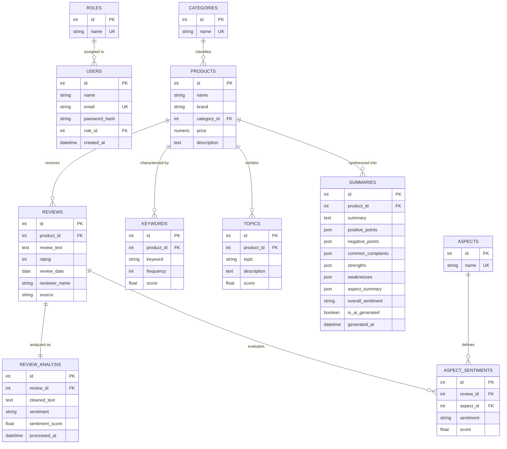

# Enterprise Systems (ES) Dossier
**Project:** Electronic Gadget Review Summarizer  
**Course Code / Subject:** Enterprise Systems (ES)  
**Academic Year:** 2026  

---

## 1. Enterprise System Overview
The **Electronic Gadget Review Summarizer** functions as an enterprise-grade Review Intelligence & Decision Support System (DSS). In contrast to rudimentary single-script NLP demonstrations, this system enforces enterprise architectural principles: multi-tier separation of concerns, Role-Based Access Control (RBAC), ACID-compliant relational data persistence in PostgreSQL 18, auditability of data transformations, and decision-support engines for product positioning.

---

## 2. Business Workflow & Problem Context
In modern consumer electronics manufacturing and retail distribution, customer feedback arrives in high volumes across multiple online platforms. Product management and quality assurance teams require answers to key operational questions:
1. Which hardware subsystem (battery, camera, display, thermals) is experiencing the highest defect/complaint rate?
2. How does our gadget's verified customer sentiment compare directly against a competitor's flagship?
3. What are the statistically distinguishing terms consumers use to describe our device?

The enterprise workflow addresses this via a closed-loop data pipeline:

---

## 3. System Architecture

---

## 4. Entity Relationship (ER) Diagram

---

## 5. Role-Based Access Control (RBAC) Authorization Matrix
| Operational Capability | ADMIN | ANALYST | USER |
| :--- | :---: | :---: | :---: |
| **View Dashboard, Catalog, & Reviews** | Yes | Yes | Yes |
| **Search & Filter Reviews in Explorer** | Yes | Yes | Yes |
| **Run Interactive NLP Demonstration** | Yes | Yes | Yes |
| **View Comparative Decision Matrix** | Yes | Yes | Yes |
| **Generate & Print Executive Reports** | Yes | Yes | Yes |
| **Submit Single Review (Self-Attributed)** | Yes | Yes | Yes |
| **Create New Catalog Gadget** | Yes | Yes | No |
| **Batch Ingest CSV Datasets** | Yes | Yes | No |
| **Trigger NLP Reprocessing on Products** | Yes | Yes | No |
| **Regenerate Executive Summaries** | Yes | Yes | No |
| **Edit / Delete Products & Reviews** | Yes | No | No |
| **User Role Promotion & Demotion** | Yes | No | No |
| **View System Operational Telemetry** | Yes | No | No |

---

## 6. Decision Support System (DSS) Logic
The comparative analysis engine does not fabricate arbitrary ratings. When two or more gadgets are evaluated side-by-side, the engine computes:
1. **Better Rated Device:** `argmax(average_rating)` calculated across verified reviews with exact numerical delta.
2. **Superior Sentiment:** `argmax(positive_percentage)` evaluated from compound polarity scores.
3. **Strength / Weakness Mapping:** High-frequency aspect polarities (e.g. Battery vs Camera) contrasted side-by-side.
4. **Key Differences:** Objective price differential and verified satisfaction margin.
